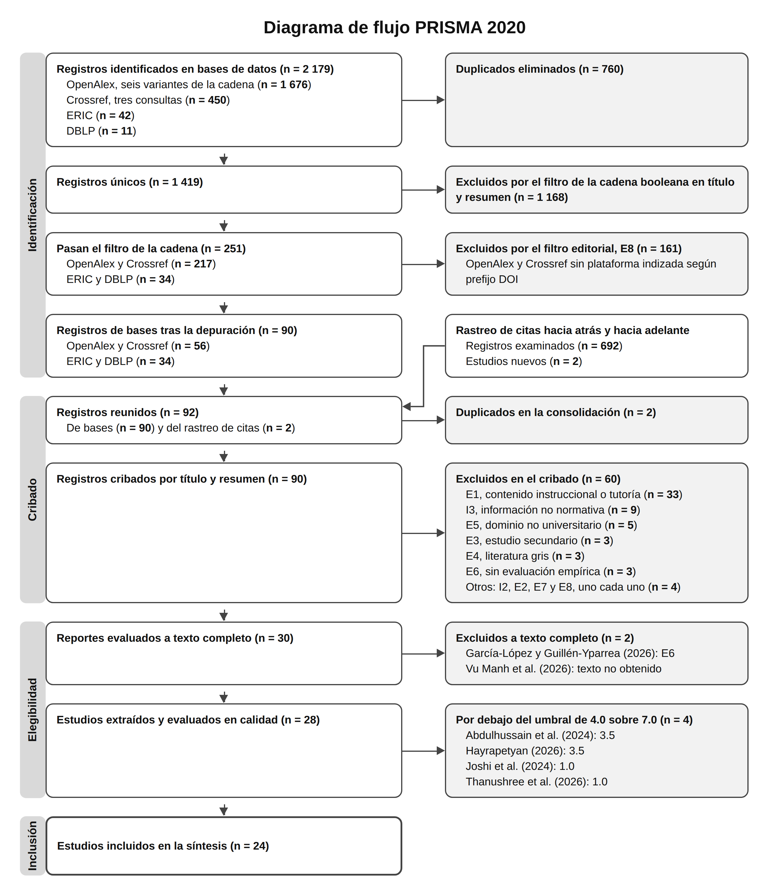

# Retrieval-Grounded Conversational Systems for Access to University Regulatory Information: A Systematic Review

**Original title:** *Sistemas conversacionales anclados en recuperación para el acceso a información normativa universitaria: revisión sistemática*

**Authors:** Edgar David Mariano Ruiz, Arnulfo Catalán Villegas and Mercedes Hernández De La Cruz
Facultad de Ingeniería, Universidad Autónoma de Guerrero. Master's program in Engineering for Innovation and Technological Development.

This repository holds the audit and reproduction materials of a systematic review (PRISMA 2020) of retrieval-augmented generation (RAG) systems applied to access to regulatory, administrative and procedural information in higher education institutions. Of 2,179 records identified in OpenAlex, Crossref, ERIC and DBLP, 90 moved on to screening, 30 to full-text assessment and 28 to extraction, and 24 passed the quality threshold of 4.0 out of 7.0.

With these files, a third party can repeat the search and review every screening, eligibility, quality and extraction decision. The review materials and the manuscript are in Spanish.



**Technologies:** Python 3.10+ (standard library only), OpenAlex, Crossref, ERIC and DBLP APIs, LaTeX with biblatex-apa.

## Contents

| Folder | What it contains |
|---|---|
| `01_protocolo/` | Frozen protocol with its deviation log (section 12), PRISMA 2020 checklist and search report |
| `02_busqueda/` | Search strings per database, manual execution guide, log of the expanded search with counts per query, retrieved records and logs |
| `03_cribado/` | Title and abstract screening log with the decision, criterion and reason for each of the 90 records; PRISMA diagram counts; capture-recapture coverage analysis |
| `04_texto_completo/` | Decision and reason for each of the 30 studies assessed at full text |
| `05_calidad/` | QA1 to QA7 score for each study, justification per criterion with the rule applied and the evidence extracted, and studies below the threshold |
| `06_extraccion/` | Extraction matrix (28 studies by 34 fields), complete JSON records and studies excluded at full text |
| `07_sintesis/` | Catalog of the included studies |
| `08_manuscrito/` | LaTeX manuscript, BibTeX references, PRISMA diagram and compiled PDF |
| `scripts/` | Search, verification, consolidation, screening and extraction programs |

The eligibility criteria (I1 to I8 and E1 to E8) are in section 4 of the protocol and in Table 1 of the manuscript. The quality instrument is in section 6 of the protocol, and the extraction form is in section 7.

## What is not included

- **Full texts of the studies.** They are third-party works protected by copyright. Each study is identified by its DOI.
- **Record abstracts.** They were removed from all files for the same reason. They can be retrieved by DOI from Crossref or OpenAlex.

The files contain no personal data of participants in the primary studies and no access credentials.

## Reproducing the search

The programs use only the standard library of Python 3.10 or later.

```bash
# Crossref and OpenAlex ask for a contact email for polite access
export CORREO_CONTACTO="your_email@example.org"

python scripts/busqueda_ampliada.py      # OpenAlex (6 variants) and Crossref (3 queries)
python scripts/buscar_eric_dblp.py       # ERIC and DBLP
python scripts/rastreo_de_citas.py       # citation tracking over the included studies
python scripts/consolidar_para_cribado.py
```

The programs write to the original working structure (`01_busqueda/automatizada/` and `02_cribado/`); the results of the September 4, 2026 run are archived in the numbered folders of this repository. Counts from a new run may vary, because OpenAlex and Crossref are updated continuously.

The five subscription databases planned in the protocol (Scopus, Web of Science, IEEE Xplore, ACM Digital Library and SpringerLink) don't allow automated queries without credentials. Their search strings, with each platform's syntax, are in `02_busqueda/cadenas_por_base.md`.

## Pending update

The capture-recapture analysis (`03_cribado/analisis_cobertura_captura_recaptura.csv`) compared the search against the set from a previous exploration and estimated a recall of 62%. The 14 eligible studies that weren't retrieved are listed in that file and will be screened in the review update.

## License

[CC BY 4.0](https://creativecommons.org/licenses/by/4.0/). See `LICENSE`.

## How to cite

Mariano Ruiz, E. D., Catalán Villegas, A., & Hernández De La Cruz, M. (2026). *Sistemas
conversacionales anclados en recuperación para el acceso a información normativa y
procedimental en instituciones de educación superior: Una revisión sistemática. Materiales de
auditoría y reproducción* (Version 4.0) [Data set]. GitHub.
https://github.com/DavidMariano300/rsl-rag-normativa-universitaria
